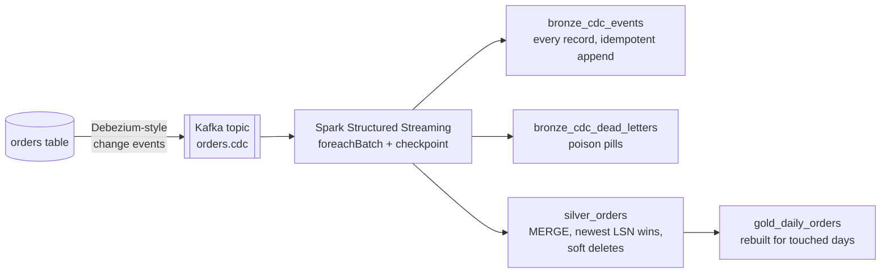

# CDC Streaming into Delta Lake

[](https://github.com/kaajjalchoudhary/cdc-streaming-lakehouse/actions/workflows/ci.yml)


Change data capture from an operational `orders` table into a lakehouse. Debezium-style change
events flow through **Kafka**, and a **Spark Structured Streaming** job applies them to
**Delta Lake** tables **exactly once**, even though delivery is at-least-once and out of order.

The stream is realistic: events are redelivered, a connector restart replays an older range of
changes *after* newer ones, deletes are followed by tombstones, and a few messages are not
JSON at all. The test suite checks that the Delta table ends up **identical to the source
table**, row for row.

## How it works



Every change carries the source database's **log sequence number (LSN)**. That single number
makes the whole pipeline order-independent:

```python
silver.merge(latest_change_per_order, "t.order_id = s.order_id")
      .whenMatchedUpdateAll(condition="s._lsn > t._lsn")   # older or duplicate events are no-ops
      .whenNotMatchedInsertAll()
```

## Exactly-once, end to end

| Failure | Why nothing breaks |
|---|---|
| A message is delivered twice | Same LSN as the row already in silver, so the MERGE skips it |
| A connector restart replays old events after newer ones | Lower LSN than silver's row, so it is skipped |
| A stale update arrives after a delete | Deletes are kept as soft-deleted rows with their LSN, so the update cannot resurrect the order |
| The job crashes after writing but before checkpointing | Spark re-runs the same batch id with the same offsets; bronze appends use Delta's `txnAppId`/`txnVersion` so they are committed once, and the MERGE is idempotent |
| A message is not valid JSON | Routed to `bronze_cdc_dead_letters` with its Kafka partition and offset; the stream keeps going |
| A tombstone (null value) arrives | Counted and kept in bronze, ignored by silver |

## Quick start

Requires Python 3.10+, Java 11 or 17, and Docker for Kafka.

```bash
git clone https://github.com/kaajjalchoudhary/cdc-streaming-lakehouse.git
cd cdc-streaming-lakehouse
python -m venv .venv && source .venv/bin/activate
make install

make kafka      # Redpanda (Kafka API) + console on http://localhost:8080
make produce    # publish ~1,700 change records to orders.cdc
make consume    # drain the topic into Delta and print the report
make test
```

No Docker? `make demo-files` runs the same job with a file source that carries the same
key/value records.

## Tests

| Suite | Covers |
|---|---|
| `test_generate.py` | A reference implementation of the LSN rule reproduces the ground truth; naive arrival-order processing does **not** (the bug this pipeline prevents) |
| `test_streaming.py` | Several micro-batches end in exactly the source table; restart from checkpoint with no loss or duplicates; replaying a batch id changes nothing; a stale update cannot resurrect a deleted order |
| `test_kafka.py` | The same guarantees through a real broker, plus every Kafka (partition, offset) lands in bronze exactly once |

CI starts Redpanda, runs every test including the Kafka one, runs the pipeline through Kafka
and posts the report to the run summary.

## Project layout

```
cdcstream/
  generate.py   change stream generator + ground truth
  sources.py    Kafka and file sources, Kafka producer
  apply.py      foreachBatch: bronze, dead letters, silver MERGE, gold
  stream.py     the streaming query and checkpoint
  report.py     lake summary
tests/
docker-compose.yml   Redpanda + console for local runs
```

## Production notes

Here the generator plays the role of Debezium. Against a real Postgres or MySQL, Debezium (or
a managed connector) writes the same envelope; the job only needs the topic name. Periodic
`VACUUM` and a purge of old soft-deleted rows would run as a separate maintenance job, and the
dead-letter table would feed an alert.

## License

MIT
